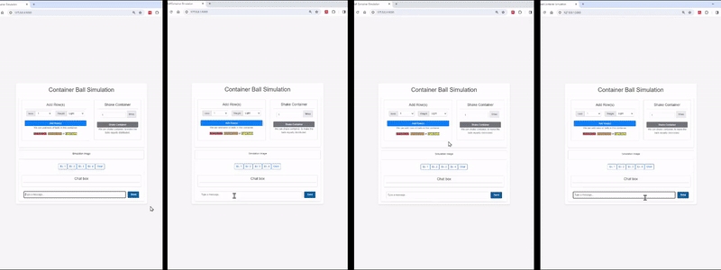
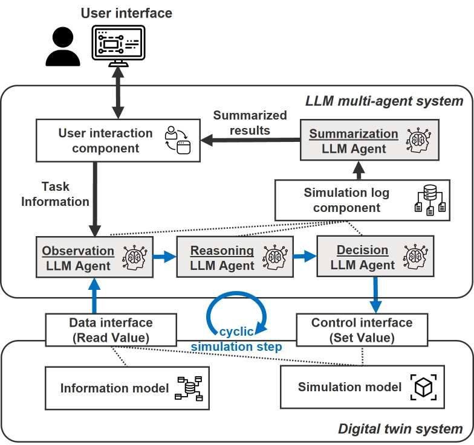
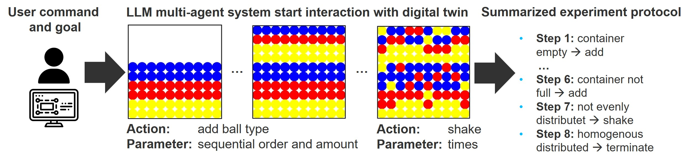
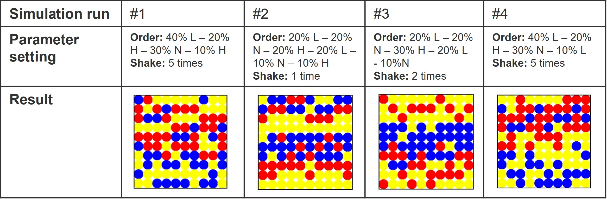

# LLM experiments with simulation
This repository contains the accompanying demo video and code for the paper: **LLM experiments with simulation: Large Language Model Multi-Agent System for Simulation Model Parametrization in Digital Twins**

(A preprint manuscript draft is available on arXiv: https://arxiv.org/abs/2405.18092)

## Related Dissertation
This work is part of the doctoral research summarized in the Ph.D. dissertation:

> Y. Xia, **Integrating Large Language Model Agents with Digital Twins for Industrial Autonomous Systems**, Doctoral Dissertation, University of Stuttgart, 2026.
>
> which presents a general framework for integrating LLMs, digital twins, and automation systems into industrial autonomous systems, including synthesised theories and multiple industrial case studies.
>
> Dissertation (Open-access): https://doi.org/10.18419/opus-18222

## How to mix a container with different ingredients?

### :woman_scientist: :man_scientist: :bar_chart:  Human performs experiment:


A demo video with higher resolution: [mix_real_experiment.mov](mix_real_experiment.mov)

### :robot: :desktop_computer: :bar_chart: LLM agent performs simulation



A demo video with higher resolution: [mix_simulation.mov](mix_simulation.mov)

## The system design
The LLM interprets the simulation steps in a cyclic manner, interacting with the data and control interface in a digital environment.

The system is designed to be **independent from a specific LLM**, meaning that any proprietary LLM or open-source LLM can be used to power the system. 

The **reasoning capability** is the most essential, and GPT-4 performs significantly better than GPT-3.5 and other open-source models.

---


---
The user provides an objective to the multi-agent system, which then experiments with the simulation to heuristically explore solutions. Finally, the LLM agent provides a summarized solution to parameterize the simulation model.

---


---


---
## Research Paper 
- **Design**: introduces a framework that integrates a multi-agent system with LLMs to interact with a simulation model and find parametrization solutions for a process.
- **Project Status**: it is currently a **work-in-progress** research project and the paper has been presented at **IEEE ETFA 2024** - IEEE International Conference on Emerging Technologies and Factory Automation (10th-13th September 2024, Padova, Italy).
- **Application Area**: we are investigating the LLMs' interaction with more sophisticated simulation models for **industrial automation systems**.

## Source code release
The folder **source_code** contains the source code for reproducibility. 

Follow the **source_code/README.md** for the source code to run the prototyp locally.

Licence: CC BY (Attribution)

## The Paper
Details of this work has been documented in a paper in Proceedings of IEEE 28th International Conference on Emerging Technologies and Factory Automation (ETFA, 10th-13th September 2024, Padova, Italy) and will be published by IEEE soon.

A preprint manuscript draft is available on arXiv:
>[Xia, Y.](https://yuchenxia.com), Dittler, D., Jazdi, N., Chen, H., & Weyrich, M. (2024). **LLM experiments with simulation: Large Language Model Multi-Agent System for Simulation Model Parametrization in Digital Twins**. https://arxiv.org/abs/2405.18092

```bibtex
@misc{xia2024llm,
      title={LLM experiments with simulation: Large Language Model Multi-Agent System for Simulation Model Parametrization in Digital Twins}, 
      author={Yuchen Xia and Daniel Dittler and Nasser Jazdi and Haonan Chen and Michael Weyrich},
      year={2024},
      eprint={2405.18092},
      archivePrefix={arXiv},
      primaryClass={cs.AI}
}
```
## About the Author
<a href="https://yuchenxia.com" target="_blank">Yuchen Xia, Ph.D.</a> specializes in LLM agents, digital twins, and industrial automation since 2021. You can find more about his work, publications and projects on his <a href="https://yuchenxia.com" target="_blank">personal website</a>.
